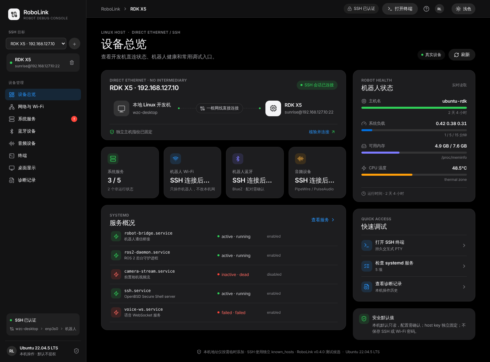
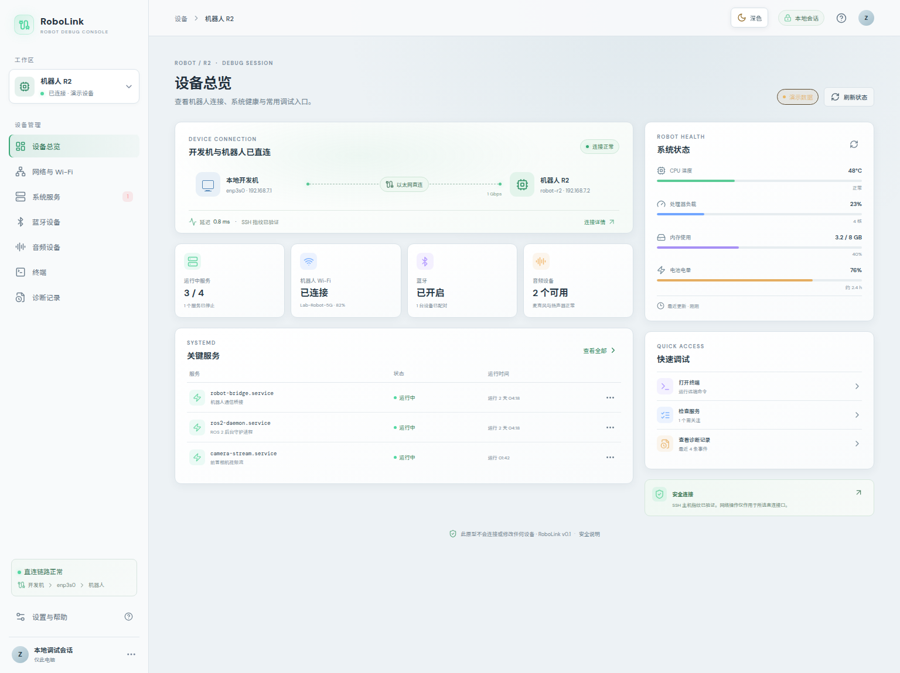

# RoboLink · 机器人调试台

RoboLink 是运行在 Linux 开发机上的无头机器人调试桌面应用。它支持经 SSH 管理 Linux 机器人，并为直接有线连接提供受限的接口发现。**有线拓扑是开发机和机器人一根网线直连，不经过路由器、交换机或中间设备。** 机器人 Wi‑Fi 是独立的远端控制对象。

## 版本状态

当前源码版本为 **0.2.0**，定位为首个可安装 Linux 测试候选版，供真实机器人试用和反馈；不宣称已在所有机器人型号、Linux 发行版或外设组合上验证。开发环境能够进行构建和自动化测试，但此任务没有接入实际机器人，因此真实硬件连接、无线配对和音频播放仍需你在自己的设备上验证。

## 当前功能

- 通过 SSH 管理多个 Linux 目标；首次连接显示主机密钥指纹，让用户选择并核对一把密钥后固定；变化时阻断连接。
- 在开发机物理有线接口上查看链路并有限发现机器人。扫描绑定到选中的接口；不会修改开发机 IP、默认路由或 DNS。
- 读取机器人概览、systemd 服务、NetworkManager Wi‑Fi、BlueZ 蓝牙、PipeWire/PulseAudio 默认输入/输出设备与音量。
- 提供交互式 SSH PTY 终端、高风险命令确认、多行粘贴预览、本地操作事件记录。
- 提供浅色/深色模式。

服务启停、机器人 Wi‑Fi、蓝牙配对/连接和音频设置会改变机器人状态，界面会要求确认；应用不自动提权。RoboLink 不会为尚未配好 IP/SSH 的机器人执行首次网络配置，因此“直接插上网线”仍须满足开发机和机器人已有可互通 IP、机器人 SSH 服务已开启。详见[第一次直连操作手册](docs/first-direct-connection.md)。

## 下载与安装

从本仓库的 GitHub Releases 下载 **RoboLink 0.2.0 的 Ubuntu 24.04 amd64 `.deb` 测试包**，在下载目录安装：

```bash
sudo apt install ./RoboLink_0.2.0_amd64.deb
```

系统会按 deb 包依赖检查桌面运行库。打开系统应用菜单中的 **RoboLink** 启动。应用运行在开发机上，机器人端不需要安装 RoboLink。

> 该安装包在 Ubuntu 24.04 x86_64 构建。其他发行版/架构需自行验证 WebKitGTK 等桌面依赖兼容性；Windows、macOS 和 Linux ARM 构建不在此版本范围内。

## 从源码运行

需要 Node.js、npm、Rust/Cargo、Tauri Linux 开发库（GTK 3、WebKitGTK 4.1 等）。浏览器模式只用于界面演示，不会连接真实机器人：

```bash
npm install
npm run dev
```

运行真实桌面功能：

```bash
npm run app:dev
```

在兼容 Linux 环境构建 deb：

```bash
npm run app:build -- --bundles deb
```

## 主机工具

开发机需要 OpenSSH 客户端（含 `ssh`、`ssh-keyscan`、`ssh-keygen`）、`iproute2`（`ip`）。可用系统工具控制器件：NetworkManager 的 `nmcli`、BlueZ 的 `bluetoothctl`、音频服务器的 `pactl`；播放测试音还需要 `speaker-test`。机器人端则需要相应的 `systemctl`、`nmcli`、BlueZ、PipeWire/PulseAudio 工具和用户权限；应用会显示缺失工具或权限错误，不会自动安装软件或执行 `sudo`。

## 目录

```text
src/                         React + TypeScript 界面
src-tauri/                   Tauri 2 Linux 外壳和 Rust SSH/设备后端
docs/product-spec.md          产品与安全规格
docs/first-direct-connection.md  无 Internet 直连操作手册
```

浏览器中的界面截图仅展示视觉设计，不表示真实设备状态：




